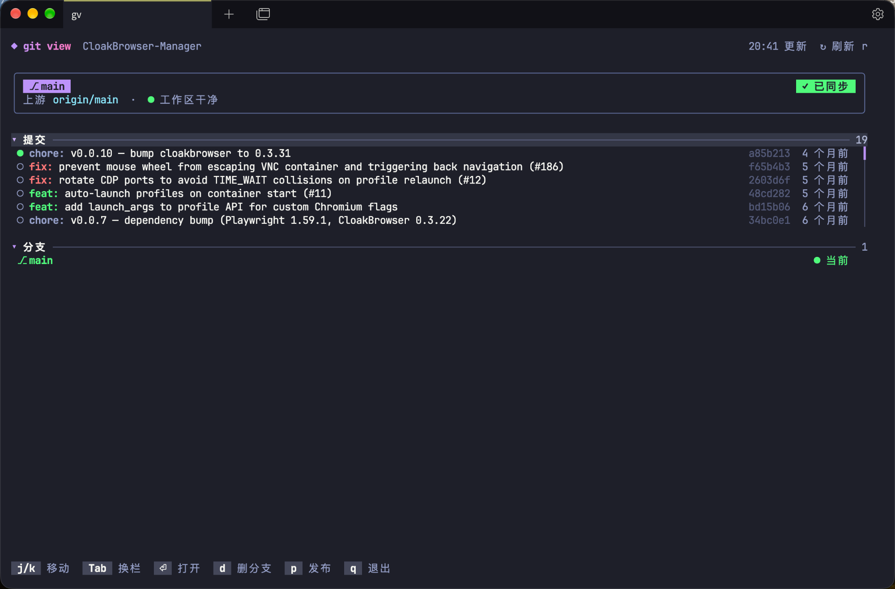

# gv — git view

**English** | [简体中文](README.zh-CN.md)

A small, good-looking terminal Git panel, in the spirit of VS Code's Source Control view.



- Current branch card: upstream, ahead/behind, published / synced status, working-tree changes
- Commit list — shows the latest 6, scroll for more (up to 200); conventional-commit prefixes (`feat:`, `fix:`, `scope:`) are color-coded
- Branch list — switch, delete (with a force-delete prompt for unmerged branches)
- Publish / push with one key
- Auto-refresh every 3 s; keyboard and mouse
- Paints its own dark background (`rgb(30, 31, 41)`), so it looks right in light terminals too

## Install

Requires Go 1.24+ and `git`.

```bash
go install github.com/cerebay/gitview/cmd/gv@latest
# or
git clone https://github.com/cerebay/gitview && cd gitview && go build -o ~/.local/bin/gv ./cmd/gv
```

## Usage

```bash
gv             # current repo
gv ~/code/xx   # a specific repo
```

When stdout is not a terminal (e.g. piped), it prints a plain-text summary instead.

| Key | Action |
|---|---|
| `j` / `k`, `↑` / `↓` | move |
| `Tab` | jump between Commits and Branches (`c` / `b` jump directly) |
| `g` / `G` | top / bottom |
| `Enter` | commit: show details · branch: switch · header: fold/unfold |
| `d` | delete selected branch |
| `p` | publish (`push -u origin <branch>`) or push |
| `r` | refresh |
| `q` | quit |

Mouse: click to select, click again to open, click a header to fold, wheel to scroll.

## Environment variables

| Variable | Effect |
|---|---|
| `GV_BG=none` | don't paint the dark background; use the terminal's own |
| `GV_COLOR=truecolor` / `256` | force the color profile. By default truecolor is assumed for `*256color` terminals that don't set `COLORTERM` (all but macOS Terminal.app) |

> Note: many shells (oh-my-zsh's git plugin) define `alias gp='git push'` — that's why this tool is called `gv`.

Built with [Bubble Tea](https://github.com/charmbracelet/bubbletea) and [Lip Gloss](https://github.com/charmbracelet/lipgloss).

## License

MIT
